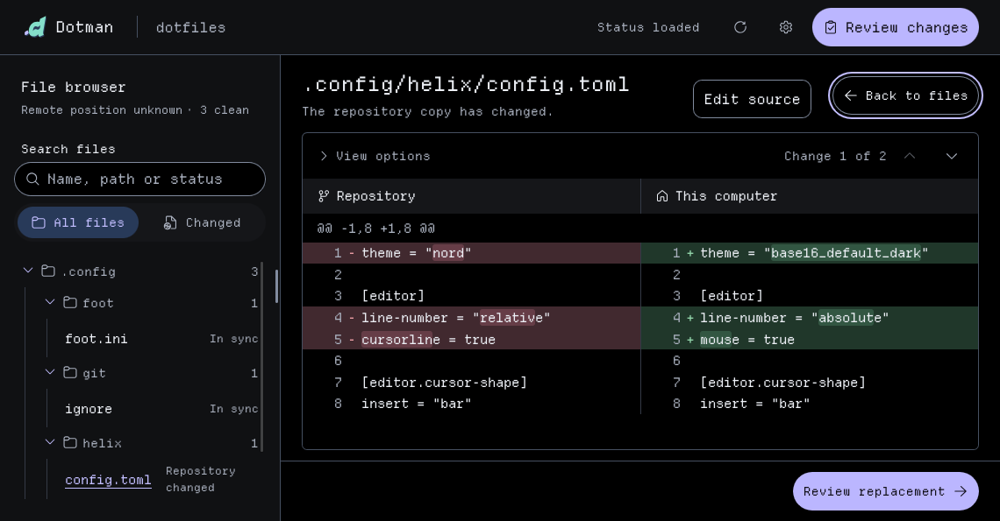
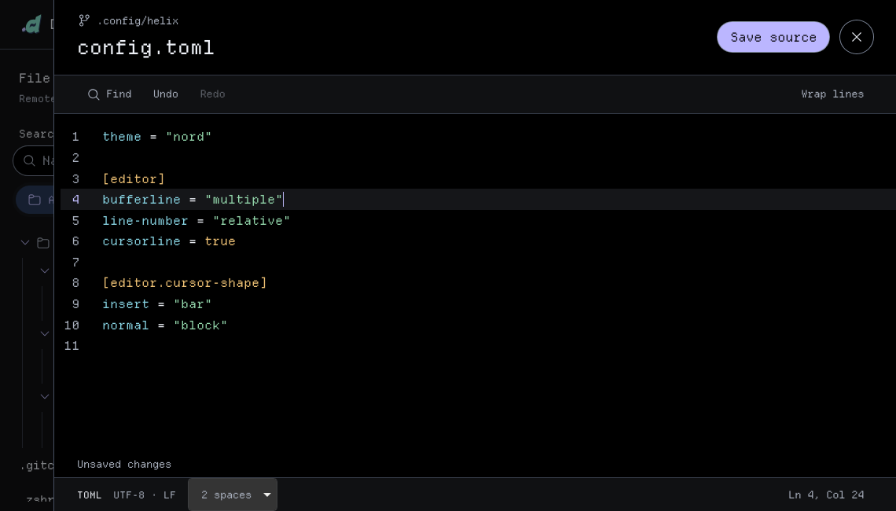
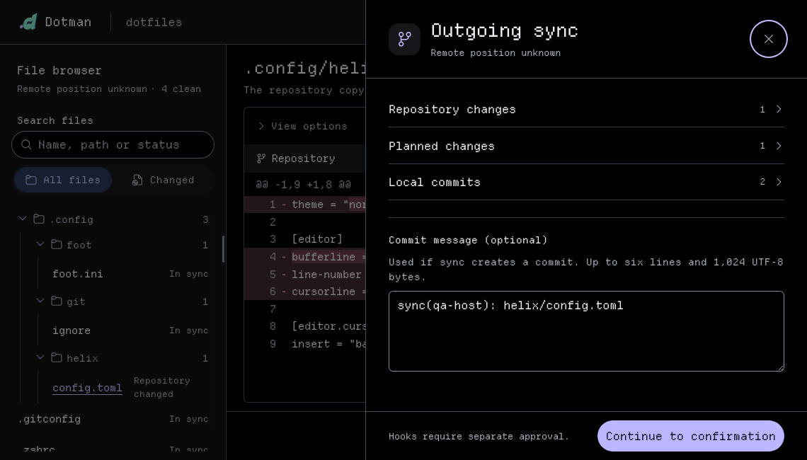
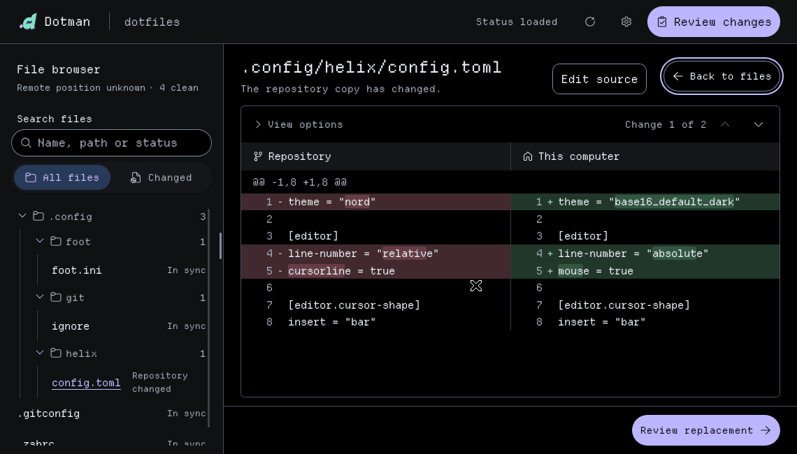

# dotman

[](https://opensource.org/licenses/MIT)
[](https://github.com/UtsavBalar1231/dotman/actions)

Manage your Linux dotfiles from a desktop app or the command line. Keep them in an ordinary Git repository and edit them where you use them. The desktop app lets you compare a file in your home directory with its repository copy, edit the source, and review what will sync.

dotman compares both copies with their last recorded state to tell which side changed. Before replacing a different file in `$HOME`, it backs up the old copy. It never writes through a symlink, runs a hook you haven't approved, or runs a command from a template.

[Run the desktop app](#linux-desktop) · [Install the CLI](#install-the-cli) · [See the desktop walkthrough](#desktop-walkthrough)



## Linux desktop

Open **dotman** from your application launcher if you installed a desktop package. Configured repositories open in **Files**. For a new setup, you can create a repository, clone one for review, or import a directory of static dotfiles once its destination is ready.

- In **Files**, select a file to compare the two copies. **Edit source** opens the repository copy in the built-in editor.
- Open **Review changes** to inspect outgoing files or select individual edits for a commit. The confirmation shows what you are about to sync.

The published Linux tarballs contain the CLI. To build the desktop app from a checkout, install Rust 1.90 or newer, Git, and the GTK 3 and WebKitGTK 4.1 development packages. Build the matching CLI and GUI side by side from the repository root. The checkout includes the frontend bundle.

```sh
cargo build --locked --release --target-dir target --bin dotman
cargo build --locked --release --manifest-path gui/Cargo.toml --target-dir target
./target/release/dotman-gui
```

For Arch, Debian and RPM packaging, supported file types, and keyboard shortcuts, see the [Linux desktop guide](docs/linux-gui.md).

### Desktop walkthrough

| Edit a repository source | Review an outgoing sync |
| --- | --- |
|  |  |

<details>
<summary>Watch a Helix edit go from comparison to sync (20 seconds)</summary>



</details>

## Command line

### Install the CLI

On Linux x86_64 or aarch64, the release installer downloads the static musl build and checks its checksum. It installs `dotman` and adds a shorter `dot` alias when the name is available.

```sh
curl -fsSL https://raw.githubusercontent.com/UtsavBalar1231/dotman/main/install/install.sh | bash
```

The [release downloads](https://github.com/UtsavBalar1231/dotman/releases) also include glibc builds for systems with glibc 2.39 or newer.

<details>
<summary>Other CLI installation options</summary>

With Cargo and Rust 1.88 or newer:

```sh
cargo install --git https://github.com/UtsavBalar1231/dotman --locked dotman-cli
```

On Arch Linux, build the package from a checkout:

```sh
cd packaging/arch
makepkg -si
```

</details>

### First sync

On your first machine, run `init`. It only asks what it can't work out for itself: your git name and email, the remote (it can create a private GitHub repo for you with `gh`), the host name and profiles, any system files, and an encryption key.

```bash
dotman init
dotman add ~/.zshrc ~/.config/nvim
dotman sync
```

On your other machines:

```bash
dotman init <url>
```

After that, edit your files where they are and run `dotman sync`. It picks up your edits, commits them, pulls, applies whatever came in, and pushes. `dotman status` tells you what's different, and `dotman diff` shows you the changes.

[Getting started](docs/getting-started.md) has the rest, such as how `sync` picks up new files in a directory you've added.

## CLI walkthroughs

<details>
<summary>Set up two machines</summary>

https://github.com/user-attachments/assets/a9fac84a-79f5-49c9-802e-d13a6b2af84b

</details>

<details>
<summary>Edit and sync files, then inspect the backups</summary>

https://github.com/user-attachments/assets/4068b53a-8dfb-46b2-a1b2-8414b8a904de

</details>

<details>
<summary>Use per-machine files, templates and secrets</summary>

https://github.com/user-attachments/assets/8bde50d1-c0ee-4340-8b72-7202184c55ae

</details>

## Documentation

- [Getting started](docs/getting-started.md): setting up in full, what dotman needs, and using it in Codespaces, Dev Containers and DevPod.
- [Linux desktop](docs/linux-gui.md) covers the editor, review drawer, setup, and matching CLI/GUI builds.
- [Daily use](docs/daily-use.md): the commands and their exit codes, how `status` and `sync` work, what happens when a pull conflicts, backups and file modes, ignoring files, and the flags that answer prompts.
- [Per-machine files](docs/per-machine.md): variants, templates and hooks.
- [Secrets](docs/secrets.md): encrypted files, your age key, and how dotman keeps credentials out of the repo.
- [System files](docs/system-files.md): files outside `$HOME`, such as in `/etc`.
- [Migration](docs/migration.md): moving over from the old dotman, yadm, a bare repo, vcsh, chezmoi or a symlink farm.

## Limitations

- macOS hasn't been built or tested. Build from source there.
- Windows isn't supported.

## Contributing

[AGENTS.md](AGENTS.md) explains the layout, the rules and the commands. Before you open a pull request, run `just lint-strict`, `cargo test --workspace --all-targets` and `just e2e`. That last one runs the scenarios in `e2e/`: several machines syncing, recovery after a killed run, and the importers. `just e2e-distros` runs the same journeys in Docker on several distros.

For desktop changes, also run `just gui-check`.

Report bugs and request features in [GitHub Issues](https://github.com/UtsavBalar1231/dotman/issues). For vulnerabilities, follow the [security reporting instructions](SECURITY.md).

## License

MIT. See [LICENSE](LICENSE).
